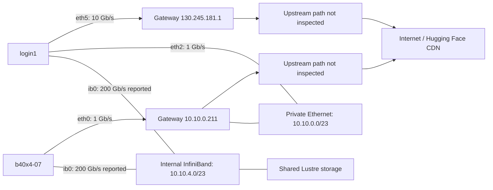

# Login-node and compute-node network layout

Observed on 2026-10-01, using `login1` and compute node `b40x4-07`. These observations describe these two hosts, not every node in the cluster.

The main difference is the interface selected for internet traffic: **`login1` uses a 10 Gb/s Ethernet link; `b40x4-07` uses a 1 Gb/s Ethernet link**. Both also have a 200 Gb/s InfiniBand connection for an internal network. The fast internal link does not automatically carry downloads from the internet.

## Observed layout

| Network | Login node `login1` | Compute node `b40x4-07` | Observed role |
|---|---|---|---|
| Internet-facing Ethernet | `eth5`, `130.245.181.10/24`, 10 Gb/s | Default route uses the private Ethernet interface below | Login node has a separate interface and gateway for external destinations |
| Private Ethernet, `10.10.0.0/23` | `eth2`, `10.10.0.210/23`, 1 Gb/s | `eth0`, `10.10.0.197/23`, 1 Gb/s | Internal Ethernet; also the compute node's first hop toward the internet |
| Internal InfiniBand, `10.10.4.0/23` | `ib0`, `10.10.4.210/23`, 200 Gb/s reported | `ib0`, `10.10.4.197/23`, 200 Gb/s reported | Internal fabric, including access to shared Lustre storage |

The compute node's `eth1`–`eth3` were down. On the login node, `eth0`, `eth1`, `eth3`, and `eth4` were down. Down interfaces did not provide extra usable download capacity during these measurements.



The diagram shows host interfaces and logical paths. It does not identify physical switches, gateway hardware, upstream bandwidth, firewall rules, or address-translation placement. In particular, **`10.10.0.211` is not `login1`'s observed private address (`10.10.0.210`)**; the evidence does not establish that compute-node downloads pass through `login1`.

## Routes to the internet

### Login node

Observed routes:

```text
default via 130.245.181.1 dev eth5 proto static metric 100
10.10.0.0/23 dev eth2 proto kernel scope link src 10.10.0.210 metric 101
10.10.4.0/23 dev ib0 proto kernel scope link src 10.10.4.210 metric 150
130.245.181.0/24 dev eth5 proto kernel scope link src 130.245.181.10 metric 100
```

For a Hugging Face address, `ip route get 3.167.112.45` selected:

```text
3.167.112.45 via 130.245.181.1 dev eth5 src 130.245.181.10
```

The request leaves on `eth5`, reaches gateway `130.245.181.1`, and continues through upstream networks. That address is an example from the observed DNS answers, not a permanent Hugging Face address. Large model data can be served by separate CDN/Xet hosts; host-wide counters during the login-node download showed about 51.0 GB received on `eth5` and no receive-byte increase on `ib0`.

### Compute node

Observed routes from the earlier compute-node session:

```text
default via 10.10.0.211 dev eth0 proto static metric 100
10.10.0.0/23 dev eth0 proto kernel scope link src 10.10.0.197 metric 100
10.10.4.0/23 dev ib0 proto kernel scope link src 10.10.4.197 metric 150
```

The same route lookup selected:

```text
3.167.112.45 via 10.10.0.211 dev eth0 src 10.10.0.197
```

Internet traffic therefore crosses the compute node's 1 Gb/s `eth0` link before reaching gateway `10.10.0.211`. Any faster upstream network still has to deliver data through this host link. The compute-node observations were recorded earlier; they were not remeasured remotely from the login node for this document.

### Why the fastest interface is not selected automatically

For the observed IPv4 routes, Linux selects a matching route based on the destination, favoring the longest matching network prefix. Traffic for `10.10.4.x` or `10.10.5.x` matches the internal `/23` route and uses `ib0`. The public Hugging Face address matches neither internal subnet, so it uses the default route. Route metrics do not make a route to an unrelated subnet eligible. This behavior follows Linux's [longest-prefix routing lookup](https://docs.kernel.org/networking/fib_trie.html).

A 200 Gb/s InfiniBand interface cannot become a faster internet path merely by asking Hugging Face to use more connections. Such a path would require a reachable internet gateway on that fabric and appropriate cluster routing. No such route was observed.

## Why the speeds differ

There are two confirmed differences: **the selected route and the operating speed of the selected Ethernet link**.

On `b40x4-07`, `ethtool eth0` reported a full-duplex 1000 Mb/s link. Its advertised and supported modes topped out at 1000 Mb/s, and it used the `tg3` driver. This was a gigabit-capable port; it was not a faster port that had simply been selected at a lower rate in the evidence we collected.

On `login1`, `eth5` used the `bnxt_en` driver and operated at 10,000 Mb/s, full duplex. Its supported modes included 1, 10, and 25 Gb/s, but the actual connection was **10 Gb/s**, not 25 Gb/s. The login node's separate private `eth2` interface still operated at 1 Gb/s. Therefore the higher rate belongs to the login node's selected external link, not to all its interfaces.

This is consistent with a cluster design that gives login or transfer hosts faster external connectivity while emphasizing internal communication and storage access on compute hosts. That design rationale is an inference. The hosts do not reveal why administrators selected those ports, cables, switch configurations, or gateway policies.

| Quantity | Compute node | Login node |
|---|---:|---:|
| Selected internet link | 1 Gb/s | 10 Gb/s |
| Raw link ceiling, before overhead | 125 MB/s | 1,250 MB/s |
| Complete model download time | 408.66 s | 67.14 s |
| Effective completed-file throughput | 136.02 MB/s | 827.95 MB/s |
| Fresh uncompressed HTTP test | 109.76 MB/s overall; 115.66 MB/s streaming | Not separately tested |

The completed login-node model download was **6.09 times faster**, rather than ten times faster. Link capacity is a ceiling; CDN performance, upstream congestion, latency, download concurrency, decompression, memory, and writes to storage can also limit end-to-end performance. The successful login-node retry used two file workers and four Xet range requests per file, whereas the compute run used eight file workers. These were not identical controlled experiments.

The compute-node model's effective 136.02 MB/s exceeds a 1 Gb/s raw link ceiling because the metric counts completed file bytes, not wire bytes. Xet supports [compressed chunks](https://huggingface.co/docs/xet/xorb); compression is a plausible explanation, but its exact contribution was not measured. The separate uncompressed transfer test fits the gigabit connection. Login-node interface counters are host-wide and can lag, so they are supporting evidence rather than exact per-process wire accounting.

## Internet speed versus storage speed

Both sessions mounted the same Lustre filesystem at `/lustre/nvwulf/scratch`. The mount source included `10.10.4.233@o2ib`, placing the observed storage endpoint on the internal fabric. A file downloaded there on the login node is already available at the same path on a compute node; a second internet download is unnecessary.

The InfiniBand figure is the reported fabric link speed, not a promise of 200 Gb/s application throughput or filesystem throughput. Reading the model from Lustre, copying it to local SSD, and downloading it from Hugging Face are different operations with different bottlenecks.

For this model, the practical workflow is to download on the faster login node and load the completed copy from shared storage:

```text
/lustre/nvwulf/scratch/decarlson/Qwen3.8-27B-login1-retry
```

## Evidence and scope

- [Original compute-node conversation and measurements](../conversations/2026-10-01-qwen-download-and-network.md)
- [Login-node download comparison](../conversations/2026-10-01-qwen-login-node-comparison.md)
- [Compute-node model download metrics](../results/2026-10-01/download-metrics.json)
- [Compute-node uncompressed transfer test](../results/2026-10-01/network-check.json)
- [Login-node model download metrics and saved routes](../results/2026-10-01/login1-download-metrics.json)
- [Structured interface and route observations](../results/2026-10-01/network-layout-observations.json)

No switch configuration, upstream router path, NAT configuration, or cluster-wide inventory was inspected. The documented layout and speed comparison apply to these observed hosts and sessions.
